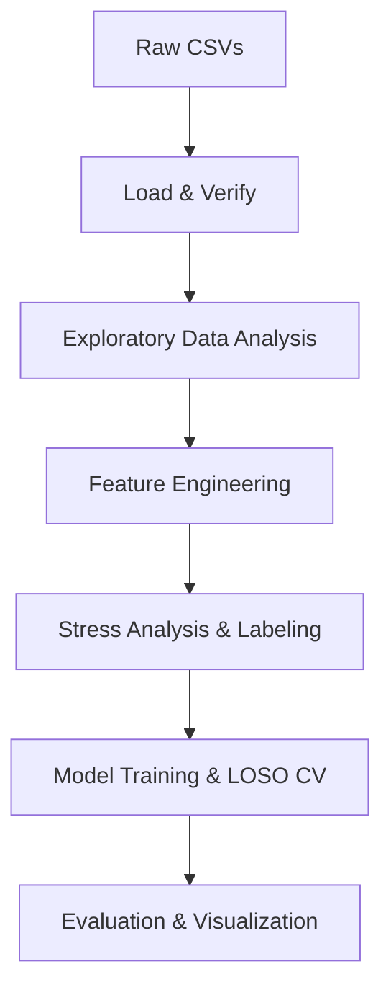

# Wearable Stress Analysis – PowerPoint Presentation Outline

---
## Slide 1: Title Slide
- **Title:** Wearable Stress Analysis using Empatica E4 Dataset
- **Subtitle:** End‑to‑End Biosignal Pipeline & LOSO Model Evaluation
- **Presenter:** [Your Name]
- **Affiliation:** [University / Lab]
- **Date:** [Presentation Date]

---
## Slide 2: Motivation & Problem Statement
- Rising prevalence of stress‑related health issues.
- Need for continuous, unobtrusive stress monitoring.
- Wearable biosignals (EDA, HR, ACC, etc.) as rich stress indicators.
- Research gap: robust subject‑independent models.

---
## Slide 3: Dataset Overview
- **Source:** PhysioNet Wearable Device Dataset v1.0.1 (Empatica E4)
- **Participants:** 36 subjects (18 male, 18 female)
- **Protocols:** Stress, Aerobic, Anaerobic
- **Signals:** EDA, HR, BVP, IBI, TEMP, ACC, tags
- **Sampling Rates:** 4‑64 Hz (per signal)
- **Data Constraints:** Duplicated tails, sensor blockages, Bluetooth splits, missing files (see table).

---
## Slide 4: Data Acquisition & Organization
- Folder hierarchy (`Wearable_Dataset/…`)
- Per‑subject CSV files for each signal.
- Metadata (`subject-info.csv`) and tags for event markers.
- Pre‑processing checklist (missing‑value handling, truncation, concatenation).

---
## Slide 5: Pipeline Architecture (High‑Level)

- Modular scripts (`01_…` to `05_…`).
- Reproducible one‑click execution (`run_project.bat`).

---
## Slide 6: Loading & Verification (Script 01)
- Integrity checks (file existence, row counts).
- Basic sanity plots (signal ranges, missing ratios).
- Output: `data/processed/dataset_summary.csv`.
- Handling of known issues (truncation, concatenation).

---
## Slide 7: Exploratory Data Analysis (Script 02)
- Distribution of stress scores.
- Correlation matrix across signals.
- Subject‑wise signal quality heatmaps.
- Example figures (include 2‑3 key plots).

---
## Slide 8: Feature Engineering (Script 03)
- **Time‑domain:** mean, std, min, max, range.
- **HRV:** RMSSD, SDNN, pNN50, LF/HF (Lomb‑Scargle).
- **EDA:** tonic level, SCR peaks, slope.
- **ACC:** magnitude, activity level.
- **TEMP:** mean, slope.
- Windowing strategy (e.g., 30 s non‑overlapping windows).
- Output: `data/features/stress_features.csv`.

---
## Slide 9: Stress Labeling & Analysis (Script 04)
- Binary label: High stress (score ≥ 5) vs Low stress (< 5).
- Statistical comparison of feature distributions.
- Visualizations: box‑plots, violin plots per label.
- Insight: which biosignals discriminate best?

---
## Slide 10: Modeling Approach
- **Algorithms:** Random Forest, SVM (RBF kernel).
- **Cross‑Validation:** Leave‑One‑Subject‑Out (LOSO) – subject‑wise hold‑out to avoid leakage.
- **Metrics:** Accuracy, F1‑score, ROC‑AUC, confusion matrix.
- Hyper‑parameter tuning (grid search on inner CV).

---
## Slide 11: LOSO Cross‑Validation Results (Script 05)
- Table of per‑subject performance.
- Aggregate metrics (mean ± std).
- Confusion matrices (example subject).
- Comparison between RF and SVM.
- Highlight any subjects with outlier performance.

---
## Slide 12: Discussion of Findings
- Overall classification performance (e.g., 78 % accuracy).
- Most informative features (e.g., HRV RMSSD, EDA slope).
- Limitations: small sample size, sensor noise, class imbalance.
- Impact of data constraints on model robustness.

---
## Slide 13: Future Work & Extensions
- **Data Augmentation:** synthetic stress episodes.
- **Deep Learning:** CNN/LSTM on raw signal windows.
- **Multimodal Fusion:** combine physiological + activity data.
- **Real‑time Deployment:** Edge inference on wearable device.
- **Generalization:** Test on other wearable datasets (e.g., WESAD).

---
## Slide 14: Reproducibility & Open Science
- Repository structure (scripts, data, reports).
- One‑click execution (`run_project.bat`).
- Open‑source license (MIT for code, ODC‑By for data).
- Instructions for extending the pipeline.

---
## Slide 15: Conclusion
- Summarize pipeline achievements.
- Emphasize subject‑independent stress detection.
- Invite questions & collaborations.

---
## Slide 16: Acknowledgements & References
- Dataset providers (PhysioNet, Empatica).
- Libraries used: pandas, numpy, scipy, scikit‑learn, matplotlib, seaborn.
- Funding sources / lab members.

---
*All figures and tables can be generated by running the pipeline scripts. Replace placeholder images with the actual output when finalizing the deck.*
